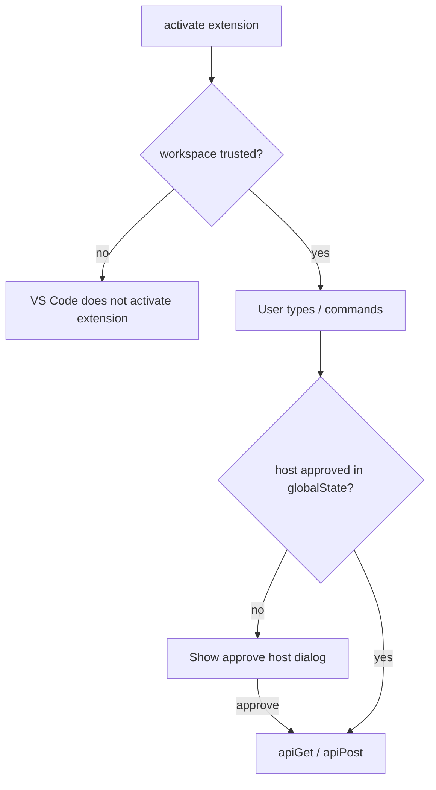

# Extension security hardening plan

## Goals

Address findings from the security review: workspace trust, safer `baseUrl` handling, no API keys in generated shell scripts, reduce accidental secret leakage from payload files, and document that **source code is sent to the configured HTTP endpoint**.

**Your policy choices**

- **Restricted Mode:** `capabilities.untrustedWorkspaces.supported: false` — extension does not run until the workspace is trusted ([workspace-trust guide](docs/vscode-api/extension-guides/workspace-trust.md)).
- **New hosts:** One-time user confirmation per host, persisted in `globalState`, before any HTTP request (`GET /models`, FiM completions).



---

## 1. Workspace Trust manifest

**File:** [`package.json`](package.json)

Add under root (sibling to `contributes`):

```json
"capabilities": {
  "untrustedWorkspaces": {
    "supported": false,
    "description": "Local AI Autocomplete sends editor and workspace file content to your configured HTTP server. Trust this workspace before enabling."
  }
}
```

Optional: `virtualWorkspaces: { supported: false }` if you want to avoid ambiguous remote-only workspaces (can be a follow-up; not required for MVP).

**Behavior:** VS Code will not call `activate()` in Restricted Mode; no extra runtime gate required for the common case. Still add a **defensive** early return in [`src/completion/provider.ts`](src/completion/provider.ts) and [`refreshModelsCommand`](src/extension.ts) using `vscode.workspace.isTrusted` so commands cannot fire if trust semantics change.

---

## 2. `baseUrl` validation and host approval

**Files:** [`src/config.ts`](src/config.ts), new [`src/security/hostTrust.ts`](src/security/hostTrust.ts), [`src/api/client.ts`](src/api/client.ts) or thin wrapper used by all HTTP entry points.

### Scheme and URL shape

Extend `validateBaseUrl()`:

- Require `protocol` is `http:` or `https:` only (reject `file:`, `javascript:`, etc.).
- Keep existing `new URL()` parse.

Surface errors in: config change handler ([`extension.ts`](src/extension.ts)), `refreshModelsCommand`, and before completion requests.

### Per-host approval (globalState)

- Key: e.g. `localAiAutocomplete.approvedHosts` → `string[]` (hostnames from `new URL(baseUrl).host`, lowercase).
- `async function ensureHostApproved(baseUrl, globalState): Promise<boolean>`:
  - If host already in list → return true.
  - Else `showWarningMessage` with host + short data-egress text; buttons **Approve** / **Cancel**.
  - On Approve → append host, return true; on Cancel → return false.
- Call from:
  - [`LocalAiInlineCompletionProvider.provideInlineCompletionItems`](src/completion/provider.ts) before `fimComplete`.
  - [`refreshModelsCommand`](src/extension.ts) before `listModels`.

Pass `ExtensionContext.globalState` into the provider (constructor) or inject a small `HostTrust` service registered in `activate`.

**Settings change:** If user changes `baseUrl` to a new host, next request triggers approval again (by design).

**Host approval copy:** Explicitly state that approving the host allows the extension to send **editor/workspace content** and, if configured, an **API key via `Authorization: Bearer`** on every request to that host.

### Revoke approved host + clear API key

**Rationale:** There is a **single global** API key in SecretStorage, not per-host. If the user revokes trust in a server, the same Bearer token may already have been sent there — clearing the key limits further exposure.

**Files:** [`src/security/hostTrust.ts`](src/security/hostTrust.ts), [`src/extension.ts`](src/extension.ts), [`package.json`](package.json), [`src/config.ts`](src/config.ts) (`setApiKey`).

| Step | Behavior |
|------|----------|
| **Command** | `localAiAutocomplete.manageApprovedServers` — Quick Pick lists hosts from `approvedHosts` (or “None” if empty). |
| **Revoke** | User picks a host → confirm: “Remove approval for `{host}`? Your stored API key will be cleared.” **Revoke** / **Cancel**. |
| **On Revoke** | Remove host from `globalState` array; `await setApiKey(secrets, '')`; `resetAuthErrorSessionFlag()`; toast: host removed, API key cleared — use **Set API Key** before requests to other servers. |
| **Revoke all** (optional) | Second pick item “Clear all approved servers…” with same key-clear behavior. |

**Not revoked automatically when:** user only changes `baseUrl` in settings (host may fall off the “approved” list logically but key stays — user must use **Manage approved servers** to revoke). Optional follow-up: if `baseUrl` host ∉ approved list, treat as unapproved on next request (already true) without clearing key unless user revokes.

**Tests:** `revokeHost` removes host from list; mock `setApiKey` called with empty string when revoke runs (unit test with injected callbacks).

---

## 3. API key handling (unchanged storage, tighter leakage paths)

Today the key is **only** in [`SecretStorage`](src/config.ts) (`localAiAutocomplete.apiKey`), read at request time in [`provider.ts`](src/completion/provider.ts) and [`refreshModelsCommand`](src/extension.ts), sent as **`Authorization: Bearer`** in [`client.ts`](src/api/client.ts). It is **not** part of the FiM JSON body captured by [`lastRequestCapture.ts`](src/api/lastRequestCapture.ts) — keep that invariant (never add headers to capture).

| Topic | Current risk | Plan |
|--------|----------------|------|
| **Settings / workspace** | Key not in `package.json` settings (good) | Document: never add `apiKey` to `contributes.configuration`; optional note in `SECURITY.md` |
| **Set API Key command** | [`showInputBox`](src/extension.ts) sets `value: current` — masked but still loads existing secret into the field | **Change:** empty `value`, `placeHolder` only (“leave empty to clear”); never echo key back in UI |
| **Generated curl** | [`saveLastPayload.ts`](src/api/saveLastPayload.ts) passes real key into `formatCurlWithPayloadFile` when set | **Remove** (see §4); curl uses `YOUR_API_KEY` or `$LOCAL_AI_API_KEY` env var only |
| **Debug / HTTP logs** | Logs URL and “(with API key)” boolean, not the secret | **Audit** `client.ts` / `output.ts`: ensure no code path logs `opts.apiKey` or `Authorization` header; add comment or assert in review |
| **Errors** | `HttpStatusError` may include server response body in message (status bar) | Accept for MVP; document that server errors are user-visible (not the outbound key) |
| **Clipboard JSON** | Body JSON has prompts only | Toast on copy: may contain **source code**, not the API key — clarify in message |
| **Host approval** | User might not realize Bearer is sent to same host | Approval dialog mentions optional API key transmission (§2) |
| **Revoke host** | Key remains after user stops trusting a server | **§2 Revoke:** clearing SecretStorage on revoke (§2) |
| **Trust** | Untrusted workspace: extension off (`supported: false`) | Prevents activation before user trusts workspace; key still user-global in SecretStorage (VS Code encrypts per OS) |

**Out of scope for this pass:** per-host API keys, key rotation UI (beyond revoke+clear), `secretStorage` on remote vs local ([extension host](docs/vscode-api/advanced-topics/extension-host.md)) — document that on Remote SSH the secret may live on the machine where the extension host runs.

**Tests:** Extend [`lastRequestCapture.test.ts`](test/unit/lastRequestCapture.test.ts) — curl output must not match a sample secret string passed to old API; optional test that captured `body` JSON has no `authorization` field.

---

## 4. Curl / payload capture hardening

**Files:** [`src/api/lastRequestCapture.ts`](src/api/lastRequestCapture.ts), [`src/api/saveLastPayload.ts`](src/api/saveLastPayload.ts)

| Change | Detail |
|--------|--------|
| **Never embed real API key** | `formatCurlWithPayloadFile` always uses `YOUR_API_KEY` or `Authorization: Bearer $LOCAL_AI_API_KEY` with a comment to `export LOCAL_AI_API_KEY=...` before running. Remove `getApiKey` usage for curl generation in `saveLastApiPayloadToWorkspace`. |
| **Save confirmation** | Before `writeFile`, `showWarningMessage`: payload may contain **full source**; recommend not committing; offer **Save** / **Cancel**. |
| **Clipboard command** | Optional short info toast: “JSON may contain source code; do not share publicly.” |

---

## 5. Logging (debug)

**File:** [`src/ui/output.ts`](src/ui/output.ts)

Current behavior already avoids raw prefix/suffix when `debug` is false (hash-only via `debugOnly` logs). **No change required** unless you want an explicit setting `localAiAutocomplete.debugLogEditorContent` (default false) that gates the JSON snippet lines when `debug` is true — **defer** unless you want stricter separation.

Document in README: enabling **debug** may log code fragments to the output channel.

---

## 6. Repository hygiene

**File:** [`.gitignore`](.gitignore)

Add:

```
local-ai-last-completions-payload.json
local-ai-last-completions-curl.sh
```

**File:** [`README.md`](README.md) — manual API testing section: warn about secrets in payload JSON and git.

---

## 7. Documentation

| File | Content |
|------|---------|
| New [`docs/SECURITY.md`](docs/SECURITY.md) | Data flow diagram (editor prefix/suffix, related files → POST to `baseUrl`); trust requirement; host approval; payload files; enterprise checklist. |
| [`docs/SPECIFICATION.md`](docs/SPECIFICATION.md) | Short § (e.g. security / trust) linking to `SECURITY.md` and manifest behavior. |
| [`docs/PROJECT_API_MAP.md`](docs/PROJECT_API_MAP.md) | Link to `SECURITY.md`. |

Align with [Workspace Trust extension guide](docs/vscode-api/extension-guides/workspace-trust.md) wording for `supported: false`.

---

## 8. Tests

| Area | File |
|------|------|
| `validateBaseUrl` rejects non-http(s) | [`test/unit/config.test.ts`](test/unit/config.test.ts) (new) or extend existing client tests |
| `formatCurlWithPayloadFile` never contains bearer from caller | [`test/unit/lastRequestCapture.test.ts`](test/unit/lastRequestCapture.test.ts) (new) |
| Host approval + revoke (host extract, list merge, revoke clears key hook) | [`test/unit/security/hostTrust.test.ts`](test/unit/security/hostTrust.test.ts) (new) with stubbed `globalState` |

No integration test for VS Code trust UI in MVP.

---

## 9. Gaps review (address during implementation)

| Gap | Risk / note | Resolution to add |
|-----|-------------|-------------------|
| **HTTP not centralized** | Only `fimComplete` and `listModels` call the network today; future callers could skip gates | Add `assertCanSendHttp({ baseUrl, globalState, secrets })` in [`src/security/httpGate.ts`](src/security/httpGate.ts) (or extend `hostTrust.ts`): `isTrusted` → valid `baseUrl` → `ensureHostApproved`; call from provider + `refreshModels` only (single choke point). |
| **Host approval UX spam** | User clicks **Cancel** on approve dialog; every debounced completion re-prompts | Track **session-denied hosts** in memory (`Set<string>`): no re-prompt until `baseUrl` changes or window reload; log once at debug. Still block HTTP. |
| **Duplicate modals** | Parallel `ensureHostApproved` while dialog open | **Single-flight** mutex: concurrent callers await one dialog result. |
| **Host identity** | `127.0.0.1` vs `localhost` vs `[::1]` are different approved entries | Normalize hostname where sensible (document: store literal `URL.host` lowercase; optional alias map `localhost` ↔ `127.0.0.1` — **defer alias** unless you want one approval for both; at minimum document in `SECURITY.md`). |
| **Approved hosts scope** | `globalState` is **user-wide**, not per-workspace | Document: approving `evil.com` in one folder applies everywhere; revoke via manage command. |
| **Trusted repo + malicious `baseUrl`** | User trusts workspace; `.vscode/settings.json` can set `baseUrl` to attacker | Mitigated by **host approval** (not by `restrictedConfigurations` — you chose `supported: false` only). Mention in `SECURITY.md`. |
| **`isTrusted` guards incomplete** | Plan lists provider + refresh only | Also gate: `copyLastApiPayload`, `saveLastApiPayload`, `manageApprovedServers` (no-op or message if untrusted). `setApiKey` may remain allowed without trust (key not sent until trusted workspace + approved host). |
| **Payload capture order** | [`fimComplete`](src/api/fim.ts) calls `setLastCapturedRequest` **before** `apiPost` | Keep order for debugging; **host gate must run in provider before `fimComplete`** so unapproved host never captures. Optional: move capture after successful response (product choice — **defer**). |
| **curl URL injection** | `formatCurlWithPayloadFile` single-quotes URL; malicious `baseUrl` in captured state | Use placeholder URL from capture; document that curl is for dev replay only; escape or reject URLs with `'` in validation (extend `validateBaseUrl`). |
| **Spec drift** | [SPECIFICATION.md](docs/SPECIFICATION.md) US-1 says invalid URL “blocked at save” | Update spec in docs pass: validation at **use time** + config change log (VS Code cannot block settings save). |
| **Trust grant without reload** | Extension inactive until trust; after grant, may need activation | Subscribe `vscode.workspace.onDidGrantWorkspaceTrust` in `activate` to `registerProvider()` + status refresh (if VS Code does not auto-reload extension). |
| **Revoke + other hosts** | Clearing global API key affects all servers | Already documented; confirm dialog text is explicit. |
| **Cache after revoke** | In-memory completion cache may hold text | Call `provider.clearCache()` on revoke host / clear all. |
| **Tests** | No test for denied-host session, single-flight, `validateBaseUrl('file://')` | Add to §8 test table. |
| **package.json** | New command not listed in §1 | Add `manageApprovedServers` to `contributes.commands` in same PR as revoke todo. |

**Still out of scope (confirmed):** `restrictedConfigurations` for `baseUrl`, per-host API keys, certificate pinning, `virtualWorkspaces` manifest.

---

## 10. Out of scope (explicit)

- Certificate pinning, SSRF blocklists for public IPs (host confirm covers user intent).
- `extensionKind` / remote networking docs-only tweak (optional README sentence).
- Telemetry / proposed API.
- Changing related-context size defaults (product decision, not security manifest).

---

## Acceptance

- Opening an **untrusted** workspace: extension does not activate; no HTTP from this extension.
- Trusted workspace + unapproved host: first completion or “Refresh models” prompts; cancel → no request.
- `baseUrl` with `file://` or invalid scheme: validation error, no request.
- Saved curl script contains **no** real API key; `.gitignore` excludes payload artifacts.
- **Set API Key** does not pre-fill the existing secret; captured payload/clipboard docs clarify key is not in JSON body.
- **Manage approved servers** → revoke removes host and **clears** stored API key after confirmation.
- `npm run compile && npm test` pass.
