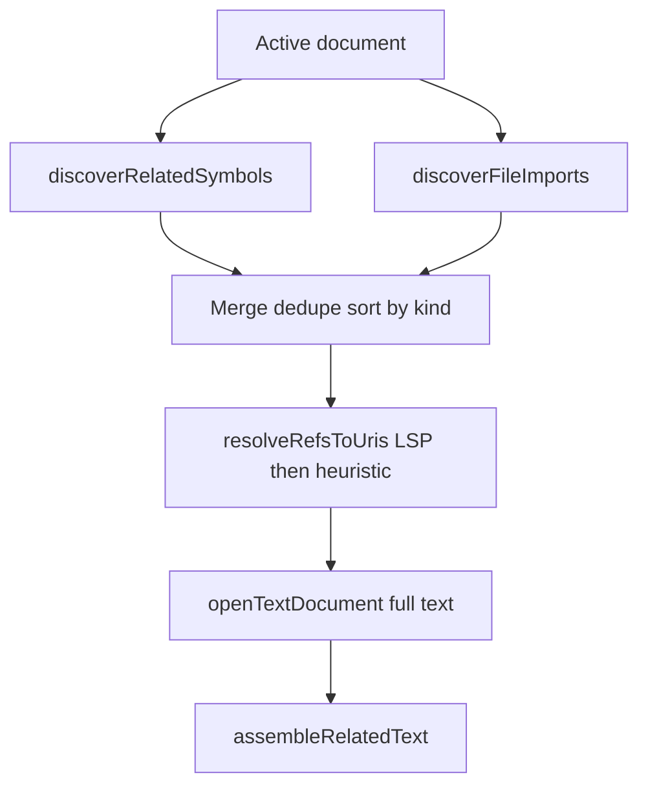

# Full class-related context (imports + declarations + vendor)

## Goal

For a class like `ProductModel`, load **all declaration-linked types and file-level imports** into the related prompt block—not only `implements ProductInterface`. Per your choices:

- **File-level imports** (`use` / `import` / `using`, etc.) — yes  
- **In-class traits** (`use HasFactory` inside `{ }`) — no (v2)  
- **Vendor / node_modules** — **include full file** when LSP or fallback resolves the URI  

## Current gaps

| Gap | Location |
|-----|----------|
| No import scanning | [`discover.ts`](src/completion/related/discover.ts) only |
| `Model` wrong position | [`addNamesFromClause`](src/completion/related/discover.ts) uses `indexOf(shortName)` → matches **`Model` inside `ProductModel`** |
| Vendor excluded from fallback | [`resolveFallback.ts`](src/completion/related/resolveFallback.ts) `EXCLUDE_GLOB` includes `vendor` |
| No post-LSP vendor filter today | LSP vendor URIs can attach; fallback cannot find `Model.php` in vendor |

## Architecture



## 1. Settings ([`package.json`](package.json) + [`config.ts`](src/config.ts))

| Key | Default | Purpose |
|-----|---------|---------|
| `relatedContextIncludeImports` | `true` | Scan file-level imports in addition to declaration line |
| `relatedContextAllowVendor` | `true` | Allow `vendor/`, `node_modules/` in fallback search and do not strip LSP results under those paths |

When `allowVendor` is `false`, restore current `EXCLUDE_GLOB` behavior (document in RELATED_CONTEXT.md).

## 2. Fix declaration name positions — [`discover.ts`](src/completion/related/discover.ts)

Replace blind `matchText.indexOf(shortName)` with **keyword-anchored** offsets:

- **extends:** locate `\bextends\s+` then parse comma-separated types; position each name after `extends` segment (handles `ProductModel extends Model`).
- **implements:** locate `\bimplements\s+` similarly (already works when no `extends`; keep unified helper).
- **inherits (`:`):** keep C-style clause logic with anchored search.

Add unit test: `class ProductModel extends Model implements ProductInterface` → refs for `Model` and `ProductInterface` with positions on the correct tokens (assert offset falls after `extends ` / `implements ` via small helper test).

## 3. File-level import discovery — new [`discoverImports.ts`](src/completion/related/discoverImports.ts)

Scan first **N lines** (same cap as declarations, e.g. 500) with **language-neutral** line regexes (no `languageId` switch required for MVP):

| Pattern family | Example |
|----------------|---------|
| PHP | `^\s*use\s+([\w\\]+)(?:\s+as\s+(\w+))?;` |
| TS/JS | `import\s+.*\s+from\s+['"]` + named/default extraction |
| Java/Kotlin/C# | `^\s*import\s+([\w.]+);` / `using\s+([\w.]+);` |

Emit `RelatedSymbolRef` with `kind: 'import'` and `position` on the **imported symbol** (for LSP). Use **alias** when present (`as Foo` → resolve `Foo` position).

Export `discoverFileImports(document): RelatedSymbolRef[]` and wire from [`relatedContext.ts`](src/completion/relatedContext.ts):

```ts
const refs = sortRefsByPriority([
  ...discoverRelatedSymbols(document),
  ...(config.relatedContextIncludeImports ? discoverFileImports(document) : []),
]);
```

## 4. Priority and deduplication — [`types.ts`](src/completion/related/types.ts), [`budget.ts`](src/completion/related/budget.ts)

- Add `RelatedSymbolKind: 'import'`.
- Priority order: `implements` → `extends` → `inherits` → `import` → `other`.
- Dedupe key: `kind:name` today; consider **`name` only** when merging duplicate `Model` from `extends` and `use` (same file once, one LSP resolve).

## 5. Vendor-aware resolution — [`resolveFallback.ts`](src/completion/related/resolveFallback.ts), [`relatedContext.ts`](src/completion/relatedContext.ts)

- Pass `allowVendor` into `resolveFallbackUri`; when `true`, use exclude glob **`**/.git/**` only** (still skip `.git`).
- After resolve, **do not** drop URIs whose path contains `/vendor/` or `node_modules` (user chose full include).
- Optional guard: if URI is outside all workspace folders, skip (security unchanged).

Log skipped vendor as **unresolved** only when `allowVendor` is false.

## 6. Budget and warnings

- Existing `relatedContextMaxFiles` (5) and `relatedContextMaxChars` (8192) still apply; **full vendor Model** may consume the whole budget.
- Debug log when files/snippets truncated by budget: `Related context: truncated (maxChars)`.
- README: warn to raise `relatedContextMaxChars` / lower `prefixMaxChars` when `allowVendor` is on.

## 7. Logging

Extend [`relatedContextLog.ts`](src/ui/relatedContextLog.ts) skipped reasons if needed: `vendor_disabled` when setting off.

Per-symbol lines already show `(lsp)` / `(heuristic)`; import refs appear as `Related resolve: Model → vendor/.../Model.php (lsp)`.

## 8. Tests

| Test | File |
|------|------|
| Extends position fix | `discover.test.ts` |
| PHP `use` lines discovered | `discoverImports.test.ts` |
| TS `import` line | `discoverImports.test.ts` |
| Priority import after extends | `budget.test.ts` |
| Fallback glob when allowVendor | mock or unit test exclude string helper |

## 9. Documentation

- [`docs/RELATED_CONTEXT.md`](docs/RELATED_CONTEXT.md) — imports, vendor policy, budget warnings, ProductModel example.
- [`docs/SPECIFICATION.md`](docs/SPECIFICATION.md) §4.1 + §6.6 — two new settings.
- [`README.md`](README.md) — short note on imports + vendor size.

## Acceptance

- `ProductModel` with `use Model`, `use HasFactory`, `extends Model`, `implements ProductInterface`: debug shows **multiple** related paths when LSP resolves them (interface + vendor Model + factory trait file if import resolves).
- `Model` no longer logs `skipped (same file)` when parent is Eloquent `Model`.
- `relatedContextIncludeImports: false` restores declaration-only behavior.
- `relatedContextAllowVendor: false` restores vendor exclusion in fallback.

## Out of scope

- In-class `use Trait` inside class body.
- Import-only symbols not present in file (unused imports still resolved if in scan range—acceptable v1).

## Gap review (add to implementation)

### Must fix in code (not fully spelled out above)

| Gap | Mitigation |
|-----|------------|
| [`extension.ts`](src/extension.ts) cache clear | Add `relatedContextIncludeImports` and `relatedContextAllowVendor` to `onDidChangeConfiguration` alongside existing related keys. |
| Ref pre-slice `maxFiles * 2` | After merge, many `use` lines can push out `implements`/`extends` refs. **Dedupe by symbol `name` first**, then sort by priority, then slice. Consider multiplier `maxFiles * 4` when imports enabled, or slice only **after** dedupe to `maxFiles` unique symbols (resolve cap). |
| `allowVendor: false` on LSP hits | Today there is no post-filter; vendor URIs from LSP already attach. When `false`, **drop** resolved URIs whose path matches `vendor` or `node_modules` (same as fallback exclusion). |
| Empty-discovery log | Change message when imports on: "no declarations or imports" vs declaration-only. |
| `RelatedSkippedReason` | Add `vendor_disabled` when URI resolved but filtered by setting. |
| Truncation debug | In [`relatedContext.ts`](src/completion/relatedContext.ts), if `assembleRelatedText` returns shorter than sum of loaded files, log `Related context: truncated (maxChars)` (may need `assembleRelatedText` to return `truncated: boolean` or compare char counts). |

### LSP vs heuristic for imports

| Gap | Mitigation |
|-----|------------|
| PHP `use Illuminate\...\Model` | Heuristic `findFiles **/Model.*` may hit wrong `Model` in app code. **LSP position must sit on the imported name** (last segment or alias) so definition is vendor. Document: `lsp_only` / working PHP LSP required for correct vendor paths. |
| Grouped PHP `use A\{B, C};` | v1: optional follow-up; if not implemented, document as unsupported (many Laravel files use single-line `use`). |
| `use function` / `use const` | Skip in v1 regex (only class-like `use FQCN;`). |

### Dedupe semantics (clarify)

- **Before resolve:** one ref per **short name** (`Model`), keeping highest-priority kind (`extends` over `import`).
- **After resolve:** existing `seenUris` prevents duplicate file content (unchanged).

### Budget / defaults

| Gap | Mitigation |
|-----|------------|
| Default `maxFiles: 5` | ProductModel may need interface + Model + HasFactory + others; **document** raising `relatedContextMaxFiles` (optional: bump default to 8 in same PR—product decision; if not, README only). |
| Full vendor files | `Model.php` can be 1k+ lines; single file may fill 8192 chars—expected; truncation log + README. |

### Tests / config drift

| Gap | Mitigation |
|-----|------------|
| `baseConfig` in [`fim.test.ts`](test/unit/fim.test.ts) / related tests | Add `relatedContextIncludeImports: true`, `relatedContextAllowVendor: true` defaults. |
| `allowVendor` LSP filter | Unit test: mock resolved path `vendor/foo.php` filtered when `allowVendor: false`. |

### Performance (document only)

- Each import line = one sequential `textDocument/definition` in [`resolveRefsToUris`](src/completion/relatedContext.ts); large import blocks add latency. No batching in v1; mention in RELATED_CONTEXT.md.

### Acceptance addendum

- With `relatedContextAllowVendor: false`, LSP-resolved `vendor/.../Model.php` does **not** appear in prompt (skipped `vendor_disabled`).
- Grouped `use` files: no crash; may miss extra symbols until v2.
