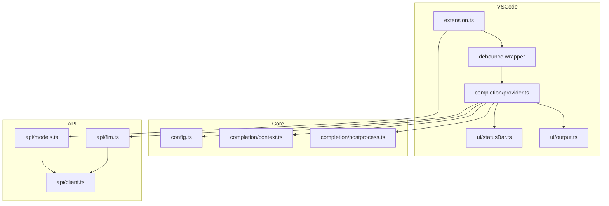

# Local AI Autocomplete — implementation plan

## Context

- **Source of truth:** [docs/SPECIFICATION.md](docs/SPECIFICATION.md) (goals G1–G5, §3–§14).
- **Repo today:** spec + [README.md](README.md) only; no extension code.
- **Resolved open decisions (§17):**
  - Extension ID / settings: `local-ai-autocomplete`, namespace `localAiAutocomplete.*`
  - API key: **SecretStorage only** (`localAiAutocomplete.apiKey`), set via command
  - Default `fimMode`: `completions_suffix`
  - `languages`: empty array = all `file` scheme documents
  - **`chat_pseudo_fim`:** included in MVP, enum value + setting default remains `completions_suffix`
  - **Tests:** unit + mock HTTP integration (per your choice)

## Target architecture



**Request path:** editor trigger → debounce (`debounceMs`) → extract prefix/suffix → `fimComplete()` → `POST {baseUrl}/completions` (or `/chat/completions` for pseudo-FiM) → post-process → `InlineCompletionItem` at cursor. Each new trigger **aborts** the previous `fetch` via `AbortController` chained to `CancellationToken`.

## Phase 1 — Extension scaffold

Create standard VS Code TypeScript extension layout:

| File | Purpose |
|------|---------|
| [`package.json`](package.json) | `engines.vscode ^1.86`, `activationEvents: ["onStartupFinished"]`, `contributes.configuration` + commands from spec §3.4 / §4.1, add `fimMode` enum: `completions_suffix`, `template`, `chat_pseudo_fim` |
| [`tsconfig.json`](tsconfig.json) | `strict`, `outDir: out`, `rootDir: src` |
| [`.vscode/launch.json`](.vscode/launch.json) + [`.vscode/tasks.json`](.vscode/tasks.json) | F5 Extension Development Host, `npm run compile` preLaunch |
| [`.gitignore`](.gitignore), [`.vscodeignore`](.vscodeignore) | Standard excludes |
| [`src/extension.ts`](src/extension.ts) | `activate` / `deactivate`: register provider, commands, config change listener |

**No runtime dependencies** for MVP; use global `fetch`. Dev: `typescript`, `@types/vscode`, `@types/node`.

Update [README.md](README.md) from “spec only” to user setup + link to spec §13 compatibility table.

## Phase 2 — Configuration and secrets

Implement [`src/config.ts`](src/config.ts):

- `getConfig()` reads all keys from spec §4.1 (including `fimTemplate` default `<PRE>{prefix}<SUF>{suffix}<MID>`).
- `normalizeBaseUrl()` — trim trailing slashes only (no auto-append `/v1`).
- `getApiKey` / `setApiKey` via `context.secrets`.
- `setModel`, `setEnabled` via `workspace.getConfiguration().update(..., Global)`.

**US-1 validation (lightweight):** on `baseUrl` change in `onDidChangeConfiguration`, parse with `URL` constructor; if invalid, log to output channel (settings UI cannot block save — document in README).

## Phase 3 — HTTP client and API modules

### [`src/api/client.ts`](src/api/client.ts)

- Shared `RequestOptions`: `baseUrl`, `apiKey`, `timeoutMs`, optional `signal`.
- `apiGet` / `apiPost` with `Authorization: Bearer` when key present.
- Per-request timeout + merge external `AbortSignal` (abort on timeout or cancellation).
- Never log bearer token; debug logs URL + method + status only.

### [`src/api/models.ts`](src/api/models.ts)

- `listModels()` → `GET /models`, parse `data[].id`, sorted (spec §5.1).
- Persist `{ ids, fetchedAt }` in `context.globalState` key e.g. `localAiAutocomplete.cachedModels`.

### [`src/api/fim.ts`](src/api/fim.ts)

- `buildCompletionsBody({ prefix, suffix, config })` per spec §5.3:
  - `completions_suffix`: `{ prompt: prefix, suffix }`
  - `template`: `{ prompt: render(fimTemplate) }`
  - `chat_pseudo_fim`: **separate** `buildChatBody()` with fixed system + user messages (fenced prefix/suffix; instruct model to output only middle) — golden strings in unit tests; document in README
- `fimComplete()` → POST `/completions` or `/chat/completions`, parse `choices[0].text` or chat `choices[0].message.content`, return `string | undefined`.

Export pure builders for unit tests.

## Phase 4 — Completion pipeline

### [`src/completion/context.ts`](src/completion/context.ts)

- `extractPrefixSuffix(document, position, prefixMaxChars, suffixMaxChars)` using `document.offsetAt` / `getText` ranges (spec §6.2).
- `documentSelector(languages)` → `{ scheme: 'file' }` or per-language selectors.

### [`src/completion/postprocess.ts`](src/completion/postprocess.ts)

- Apply `stop` sequences client-side.
- `trimOverlapWithSuffix(middle, suffix)` (spec §6.4).
- Trim duplicate leading whitespace vs prefix tail (simple heuristic).
- Clip at suffix alignment when model over-generates into existing suffix (§3.3).
- Cap processed middle length before returning (§6.4).

### [`src/completion/provider.ts`](src/completion/provider.ts)

`LocalAiInlineCompletionProvider` implementing spec §3.2–§3.3:

| Concern | Approach |
|---------|----------|
| Skip conditions | disabled, no model/baseUrl, non-empty selection (optional skip), wrong scheme |
| Debounce | Outer wrapper in `extension.ts` so `provideInlineCompletionItems` returns a Promise resolved after `debounceMs`; cancel prior pending debounce |
| Abort | New `AbortController` per completed debounce; link to VS Code `token` |
| Cache | TTL ~5s; key includes `document.uri`, `document.version`, `model`, `fimMode`, prefix/suffix hash; max 50 entries; invalidate on accept / partial accept (§6.5, §11) |
| Selection | Skip request when editor has non-empty selection (§6.3) |
| Errors | catch → log + status bar `error`; return `undefined` (spec §10) |
| Handlers | `handleDidPartiallyAcceptCompletionItem` (adjust cache), `handleDidAcceptCompletionItem` for 200ms accept guard |

Register with `registerInlineCompletionItemProvider(documentSelector(cfg.languages), debouncedProvider)`. Store registration `Disposable`; on `localAiAutocomplete.languages` or `enabled` change, dispose and re-register (or disable no-op provider when off).

## Phase 5 — Commands and UX

### [`src/ui/statusBar.ts`](src/ui/statusBar.ts) + [`src/ui/output.ts`](src/ui/output.ts)

States per spec §8.1: `disabled`, `ready`, `loading`, `error`, `no_model`. Status item command: `selectModel`.

### Commands (spec §3.4)

| Command | Implementation notes |
|---------|---------------------|
| `enableToggle` | Flip `localAiAutocomplete.enabled` |
| `refreshModels` | `listModels`, toast count on success, **error toast** on failure |
| `selectModel` | Quick pick from `globalState`; auto-refresh if cache empty |
| `setApiKey` | `showInputBox` password → SecretStorage |
| `showOutput` | Show output channel |

### Onboarding (spec §8.2)

First run: if `enabled` and no `model`, one-time `globalState` flag → info message with Open Settings / Refresh Models.

## Phase 6 — Automated tests

Use **Node test runner** (`node:test` + `node:assert`) to avoid extra test framework weight; run via `npm test` after compile or test TS sources with `tsx`/`ts-node` if preferred — **recommend compiling `src` and testing pure modules from `out/` or duplicate test-only imports from `src` via separate `tsconfig.test.json`**.

### Unit tests (`src/**/*.test.ts` or `test/unit/`)

- `extractPrefixSuffix` — cursor at start/middle/end, truncation bounds
- `postProcessCompletion` — stop tokens, suffix overlap
- `buildCompletionsBody` / `buildChatBody` — all three `fimMode` values
- Response parsers — fixture JSON for completions + chat

### Mock HTTP integration (`test/integration/`)

- Minimal `http.createServer` mock:
  - `GET /v1/models` → OpenAI list shape
  - `POST /v1/completions` → `{ choices: [{ text: "..." }] }`
- Instantiate provider (or thin test harness calling `fimComplete` + provider with mocked config) against `http://127.0.0.1:<randomPort>/v1`
- Assert: `listModels` + `fimComplete` success; 500/timeout → throw or undefined per layer; abort does not throw
- Add `POST /chat/completions` route for `chat_pseudo_fim` integration case
- Abort test: overlapping requests with shared signal/controller

Add `npm test` script in `package.json`. Use `tsconfig.test.json` including `test/**` and compile tests separately, or run tests against compiled `out/` + `test/` JS.

## Phase 7 — Verification

Manual checklist from spec §12.3 / §14:

1. F5 → configure LM Studio (or mock) URL → refresh → select model  
2. Mid-block FiM ghost text  
3. Fast typing — stale requests dropped  
4. Bad API key — silent inline, status error  
5. Toggle off — no requests (verify via mock server log or network)

Mark acceptance criteria in README or keep as internal QA list.

## File tree (final)

```text
package.json
tsconfig.json
README.md
docs/SPECIFICATION.md
src/
  extension.ts
  config.ts
  api/client.ts, models.ts, fim.ts
  completion/context.ts, postprocess.ts, provider.ts
  ui/statusBar.ts, output.ts
test/
  unit/...
  integration/mockServer.test.ts
.vscode/launch.json, tasks.json
```

## Risks and mitigations

| Risk | Mitigation |
|------|------------|
| Servers differ on FiM wire format | Document §13 matrix in README; user switches `fimMode` / `fimTemplate` |
| `chat_pseudo_fim` quality varies | Label “escape hatch” in settings enum description |
| Debounce + Promise provider edge cases | Single pending debounce slot; resolve previous with `undefined` when superseded |
| VS Code API optional methods | Type against `@types/vscode@1.86`; guard optional handlers with `?.` |

## Out of scope (explicit)

Streaming, RAG/multi-file context, SSRF warnings, server capability probe, marketplace publish — per spec §1.3 / §15.

---

## Gap review (spec vs plan)

Findings from cross-checking [docs/SPECIFICATION.md](docs/SPECIFICATION.md). Items marked **fixed in plan** have added tasks or text below; **accepted** are intentional MVP tradeoffs.

### Functional / behavioral gaps

| Spec reference | Gap | Resolution |
|----------------|-----|------------|
| §3.3 partial accept | Plan mentioned handler but not **cache invalidation keyed by accepted prefix length** | On partial accept, shrink or invalidate cache entry; do not reuse full completion text |
| §3.3 multi-line | **Trim when model runs past suffix alignment** not explicit | Add `postprocess.ts` step: if generated text contains suffix overlap beyond head trim, clip at first suffix match |
| §6.3 cache | Cache key should include **document version** (or `document.uri` + `version`) | Include `document.version` in cache key; clear on accept |
| §6.4 post-process | **Cap display length** (avoid UI freeze) not in plan | Cap processed middle (e.g. 8k chars or `4 * maxTokens` heuristic) before returning item |
| §6.4 post-process | Leading whitespace vs prefix tail marked optional | **Include** simple heuristic in MVP (low cost) |
| §6.3 skip | Non-empty selection skip listed as optional | **MVP decision: skip** when `!selection.isEmpty` to reduce noise |
| §5.1 models cache | **Timestamp** alongside model list in `globalState` | Store `{ ids, fetchedAt }`; show age in debug log; optional stale hint in selectModel placeholder |
| §5.1 | `autoSelectFirstModel` setting | **Defer** (spec optional, default false); document in §17 sync |
| §10 auth errors | **Log 401/403 once per session** | Add session flag in `extension.ts` or output module to avoid log spam |
| §10 / §8.3 | **Clear status bar `error` on next success** | Reset to `ready` after successful completion or successful model refresh |
| §8.1 loading | Loading only during HTTP, not during debounce | **Accepted**: status `loading` only after debounce fires (matches “fetching completion”) |
| US-1 | Spec says “invalid URL blocked at save”; VS Code cannot block settings save | **Accepted**: validate on change + output log; note discrepancy in README |
| §4 `languages` | Changing allowlist requires **re-registering** provider | Hold `Disposable` from `registerInlineCompletionItemProvider`; dispose + re-register on `languages` / enable change |

### API / FiM gaps

| Item | Gap | Resolution |
|------|-----|------------|
| §5.3 request body | All fields not enumerated in plan | Every `POST` includes `model`, `max_tokens`, `temperature`, `stop`, `stream: false` (+ `prompt`/`suffix` or chat `messages`) |
| `chat_pseudo_fim` | Prompt structure undefined | Define constant in `fim.ts`: system + user message with fenced `prefix`/`suffix` and instruction to emit **only** the middle; unit-test golden strings |
| Empty / malformed API | Edge cases thin in tests | Unit tests: empty `choices`, missing `text`, chat without `message.content` → `undefined` |
| `suffix` on template mode | Spec: template sends **no** suffix field | Ensure `buildCompletionsBody` omits `suffix` when mode is `template` |

### Architecture / lifecycle gaps

| Item | Gap | Resolution |
|------|-----|------------|
| `deactivate` | Timers, pending debounce, abort, status bar dispose | Clear debounce timer; abort in-flight; `statusBar.dispose()`; dispose provider registration |
| Disabled (US-5) | Network during debounce window | Debounce wrapper **returns immediately** when `!enabled` without scheduling |
| Config scope | Workspace vs global for `model`/`baseUrl` | Use **ConfigurationTarget.Global** for `model` and `enabled`; read `baseUrl` from workspace with global fallback (VS Code default) — document in README |
| Extension metadata | `displayName`, `publisher`, `categories`, `repository` | Add to Phase 1 `package.json` (minimum for F5 and future publish) |

### Testing gaps

| Item | Gap | Resolution |
|------|-----|------------|
| §12.1 `extractPrefixSuffix` | Depends on `vscode.TextDocument` | **Unit test via minimal stub** (`getText`, `offsetAt`, `lineCount`) in `test/unit/context.test.ts` — no `@vscode/test-electron` required for MVP |
| §12.2 provider integration | Full provider needs editor host | Integration tests focus on **`fimComplete` + `listModels` + HTTP client`** against mock server; optional thin wrapper that calls provider logic without full VS Code API |
| Debounce / abort | Not in integration list | Add test: two rapid `fimComplete` calls with abort — second wins, first rejects with `AbortError` |
| `chat_pseudo_fim` | Mock only `/completions` today | Mock server also implements `POST /chat/completions` for integration test |

### Documentation / process gaps

| Item | Gap | Resolution |
|------|-----|------------|
| §16 spec | Still says implementation out of scope | **spec-sync** todo: update deliverables table when coding starts |
| §17 open decisions | Stale vs plan resolutions | Fold resolved decisions into §17; leave `autoSelectFirstModel` and SSRF as deferred |
| README | `chat_pseudo_fim` limitations | Dedicated subsection: not true FiM, higher latency, model-dependent quality |

### Security / logging (§9)

| Item | Gap | Resolution |
|------|-----|------------|
| Debug logging | Must not log full prefix/suffix by default | `log()` logs char counts + hashes unless `debug` is true; even in debug, cap logged snippet (e.g. 200 chars each side) |

### Not gaps (already covered)

- G1–G5, commands §3.4, settings §4.1 (except autoSelectFirstModel), FiM modes (1)+(2)+chat escape hatch, SecretStorage, silent inline errors, manual refresh toast, onboarding, compatibility table in README, bounded cache size 50.
