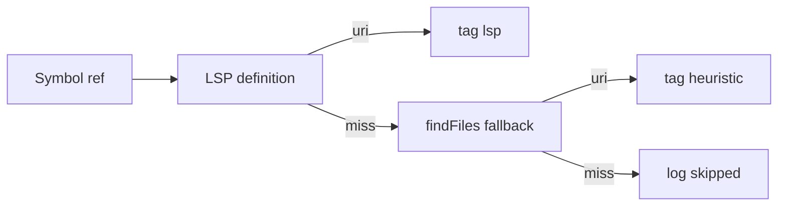

# Log LSP vs heuristic for related context

## Today

You **cannot** see LSP vs heuristic in the log. [`gatherRelatedContext`](src/completion/relatedContext.ts) tries LSP first in `auto`, then fallback, but only logs paths via [`logRelatedContextDebug`](src/ui/output.ts).

**Indirect check now:** set [`relatedContextStrategy`](package.json) to `lsp_only` (no fallback) or `heuristic_only` (no LSP) and see if files still attach.

## Target behavior (when `debug: true`)

1. **Strategy line** (once per completion):  
   `Related resolution strategy: auto` (or `lsp_only` / `heuristic_only`).

2. **Summary line** (existing, enhanced):  
   `Related context: 1 file(s), 1721 chars — app/Models/ProductInterface.php (lsp)`

3. **Per-symbol detail** (debug):  
   - `Related resolve: ProductInterface → app/Models/ProductInterface.php (lsp)`  
   - `Related resolve: Model → skipped (unresolved or excluded)`  
   - If LSP failed and heuristic won: `… (heuristic)`

When `debug: false`, keep current short messages (paths only or `none`); no per-symbol spam.



## Code changes

### 1. Types — [`src/completion/related/types.ts`](src/completion/related/types.ts)

- `RelatedResolveSource = 'lsp' | 'heuristic'`
- `RelatedResolvedEntry { symbol: string; relativePath: string; source: RelatedResolveSource }`
- Extend `RelatedContextResult` with `entries: RelatedResolvedEntry[]` (empty when no related text).

### 2. Resolution — [`src/completion/relatedContext.ts`](src/completion/relatedContext.ts)

In `resolveRefsToUris`, record how each URI was obtained:

- After LSP returns URI → `source: 'lsp'`
- Else after `resolveFallbackUri` → `source: 'heuristic'`
- For each ref with no URI (or self-uri): append to a `skipped: { symbol, reason }[]` list for logging only (`unresolved`, `same_file`)

Return `{ uri, ref, source }` from resolver; map to `entries` when building snippets.

Log strategy once at start of resolve (debug-only via `log(..., true)`).

### 3. Provider — [`src/completion/provider.ts`](src/completion/provider.ts)

Pass `related.entries` (and optional `skipped`) to logging instead of only `paths`.

### 4. Output — [`src/ui/output.ts`](src/ui/output.ts)

Replace or extend `logRelatedContextDebug` signature, e.g.:

```ts
logRelatedContextDebug({
  strategy,
  charCount,
  text,
  entries: { relativePath, source, symbol }[],
  skipped?: { symbol, reason }[],
})
```

- Summary: join paths as `path (lsp)` / `path (heuristic)`
- Debug: one line per `entries` and per `skipped`

### 5. Tests

- Unit test resolver logic with injected fake `resolveDefinitionUri` / `resolveFallbackUri` (optional small extract) **or** test logging formatter in `output.test.ts` / new `relatedResolveLog.test.ts` with fixed `entries` input.
- No Extension Host required.

### 6. Docs

- [`docs/RELATED_CONTEXT.md`](docs/RELATED_CONTEXT.md) — § Operations: debug lines for strategy and `(lsp)` / `(heuristic)`.
- [`README.md`](README.md) — one bullet under Related context.

## Out of scope

- Logging import/`use` resolution (not implemented yet).
- Persisting resolution stats across sessions.
