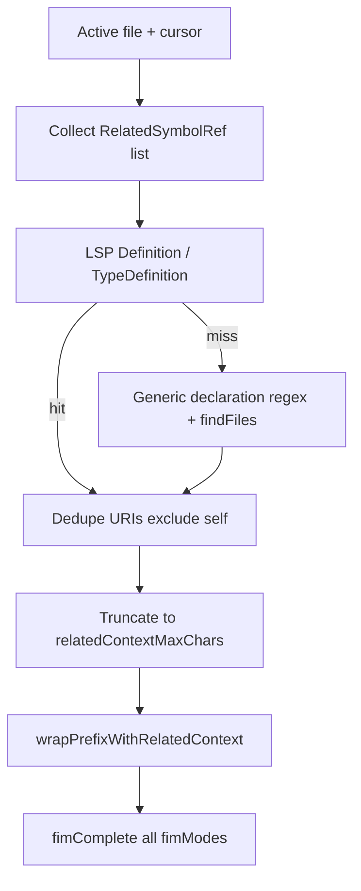

# Related context for completions (language-agnostic)

## Problem

[`src/completion/context.ts`](src/completion/context.ts) only sends text from the **active document** (prefix/suffix). Contracts defined in other files (interfaces, base types, traits) never reach the model. Spec §1.3 still lists multi-file context as a non-goal; this feature updates that.

## Design principles

- **LSP-first:** Use VS Code’s built-in providers (`executeDefinitionProvider`, then `executeTypeDefinitionProvider`) so any language with a working language extension resolves symbols without custom parsers in this repo.
- **Generic fallback only:** If LSP returns nothing, use **language-neutral** text patterns (e.g. `implements` / `extends` / `:` type lists on `class`/`struct`/`interface` lines) plus `workspace.findFiles` + content sniff (`interface|class|trait|type` + symbol name)—not dedicated PHP/TS/Java modules.
- **Prompt-only:** Wrap context for the API; [`postProcessCompletion`](src/completion/postprocess.ts) and ghost-text insertion still use the **raw** editor prefix/suffix from [`provider.ts`](src/completion/provider.ts).

## New settings ([`package.json`](package.json) + [`src/config.ts`](src/config.ts))

| Key | Default | Purpose |
|-----|---------|---------|
| `includeRelatedContext` | `true` | Master switch |
| `relatedContextMaxChars` | `8192` | Total chars for all snippets |
| `relatedContextMaxFiles` | `5` | Cap distinct files per request |
| `relatedContextStrategy` | `auto` | `auto` \| `lsp_only` \| `heuristic_only` |

Document that **related + prefix** must fit the inference server context window; users may lower `prefixMaxChars` or `relatedContextMaxChars`.

## New modules (under `src/completion/related/`)

| File | Responsibility |
|------|----------------|
| [`relatedContext.ts`](src/completion/relatedContext.ts) | Orchestrator: `gatherRelatedContext(document, config, token)` |
| `types.ts` | `RelatedSymbolRef { name, position?, kind }` |
| `discover.ts` | Generic regex scan of document for type names on declaration lines (`implements`, `extends`, trailing `: Type, Type` on class-like lines); compute `position` on each name for LSP |
| `lsp.ts` | Thin wrappers: definition → typeDefinition; normalize `Location` / `LocationLink` to `Uri` |
| `resolveFallback.ts` | `findFiles('**/{Name}.*', exclude node_modules/vendor/.git)`; pick file whose text matches `\b(interface\|class\|trait\|type\|struct)\s+{Name}\b` (best effort) |
| `budget.ts` | Dedupe, priority (`implements` > `extends` > other), per-file headers `// File: {relativePath}\n`, truncate |
| `prompt.ts` | `wrapPrefixWithRelatedContext(related, prefix)`; `appendRelatedToChatUserMessage` for `chat_pseudo_fim` |

Exclude globs: `**/node_modules/**`, `**/vendor/**`, `**/.git/**`.

## Wire-up changes

1. **[`src/api/fim.ts`](src/api/fim.ts)** — Extend `FimRequest` with optional `relatedContext?: string`. In `buildCompletionsBody` / `buildChatBody`, use **effective prefix** = `wrapPrefixWithRelatedContext(relatedContext, prefix)` for API fields; `renderFimTemplate` still substitutes **editor** `{prefix}` / `{suffix}`, then prepend related block outside the template (same as draft: related is not part of FiM placeholders).

2. **[`src/completion/provider.ts`](src/completion/provider.ts)** — After `extractPrefixSuffix`, await `gatherRelatedContext` (or `''` if disabled) **before** cache lookup (see Final gaps). Pass `relatedContext` to `fimComplete`. Extend cache key with `simpleHash(relatedContext)`.

3. **[`src/ui/output.ts`](src/ui/output.ts)** — When `debug`, log related file count, relative paths, and total chars (no full dump unless already snippet-style).

4. **[`src/extension.ts`](src/extension.ts)** — On related settings change: `provider.clearCache()` only (no `registerProvider()`).

## Discovery algorithm (language-agnostic detail)

1. Scan first ~500 lines (or full doc if smaller) for declaration patterns; emit unique `RelatedSymbolRef` with `kind`.
2. For each ref (up to `relatedContextMaxFiles`), if strategy allows LSP and `position` is set, resolve URI; skip self.
3. If no URI and strategy allows heuristic, run `resolveFallback(name, workspaceFolder)`.
4. `openTextDocument` + read text; append to bundle until budget exhausted.
5. On cancellation token, abort gather early.

No `languageId` switch tables; optional tuning is only “does this line look like a type declaration?” regex shared across languages.

## Tests

| Location | Coverage |
|----------|----------|
| `test/unit/related/discover.test.ts` | Generic regex: `class Foo implements Bar, Baz`, `class X extends Y`, C#-style `: I1, I2` on one line |
| `test/unit/related/prompt.test.ts` | Wrap empty vs non-empty; chat append |
| `test/unit/related/budget.test.ts` | Dedupe, truncation, header overhead |
| [`test/unit/fim.test.ts`](test/unit/fim.test.ts) | `buildCompletionsBody` with `relatedContext` changes prompt only, not `suffix` field behavior |

LSP paths stay untested in Node (no Extension Host); keep `lsp.ts` thin.

## Documentation and specification alignment

**Canonical product spec:** [`docs/SPECIFICATION.md`](docs/SPECIFICATION.md) stays the single source of truth for goals, settings, pipeline, acceptance, and deliverables.

**Supplement (new):** [`docs/RELATED_CONTEXT.md`](docs/RELATED_CONTEXT.md) — technical deep-dive for related context only (discovery, LSP, fallback, budgets, limitations). SPEC points here with one paragraph + link; avoid duplicating full algorithm prose in both files.

**User guide:** [`README.md`](README.md) — short “Related context” subsection (settings, LSP tip, total prompt size vs vLLM).

### Edits to [`docs/SPECIFICATION.md`](docs/SPECIFICATION.md) (checklist)

| Section | Change |
|---------|--------|
| **Header** | Bump to **Spec 1.1** (or add “Changelog” line: related context). |
| **§1.2 MVP goals** | Add **G6** (optional): “Related workspace definitions may be included in the model prompt when enabled.” |
| **§1.3 Non-goals** | Remove “multi-file context beyond the current document”; replace with: “Full-workspace RAG/indexing, embedding search, and automatic inclusion of all open tabs” remain non-goals. |
| **§2.2 User stories** | Add **US-7**: implement/extend a type whose contract lives in another file → related definitions appear in prompt (debug confirms paths). Update **US-2/US-3** wording to match **manual `model` string** + refresh logs ids (spec still says “dropdown”; align with §8.3). |
| **§3.3 Inline completion** | Note partial-accept handlers as **deferred/removed** if not in code (align spec with implementation). |
| **§4.1 Settings table** | Add `includeRelatedContext`, `relatedContextMaxChars`, `relatedContextMaxFiles`, `relatedContextStrategy` (defaults per plan). |
| **§5.3 FIM modes** | Add subsection **“Related context and FiM”**: related block is prepended to API `prompt` (or chat user message); editor `{prefix}`/`{suffix}` for template placeholders remain **unwrapped**; table from “Gap review” per `fimMode`. |
| **§6.1 Data flow** | Extend sequence diagram: after `extract prefix/suffix`, add `gatherRelatedContext` → pass to `FimClient`. |
| **§6.2** | Clarify suffix still extracted for post-process even when `fimMode` is `completions` (no API suffix). |
| **§6.5 Caching** | Extend cache key: `hash(relatedContext)`; note `clearCache` on related settings change. |
| **New §6.6 Related context** | Normative summary: purpose, LSP-first + heuristic fallback, workspace-only reads, budgets, fail-open, link to `RELATED_CONTEXT.md`. |
| **§7.1 Module layout** | Add `completion/relatedContext.ts`, `completion/related/*`, `api/fim.ts` accepts `relatedContext`. |
| **§9 Security** | Extend “Data residency”: related workspace file contents are sent to the same `baseUrl` when feature enabled. |
| **§11 Performance** | Note extra latency from LSP/findFiles per debounced request; parallel resolution. |
| **§12 Testing** | Add unit tests for discover/prompt/budget; FIM + relatedContext matrix. |
| **§14 Acceptance** | Add checkbox: related context on/off; debug shows related paths when enabled. |
| **§15 Roadmap** | Remove “Multi-file context (open tabs, imports)”; split into done (§6.6) vs future (RAG, open tabs, symbol-at-cursor). |
| **§16 Deliverables** | Add `docs/RELATED_CONTEXT.md`. |
| **§17 Resolved decisions** | Add row: related context default on; strategy `auto`; no per-language parsers. |

### Contents of new [`docs/RELATED_CONTEXT.md`](docs/RELATED_CONTEXT.md)

1. Scope and non-goals (language-agnostic; no RAG).
2. Settings reference (mirror §4.1 rows).
3. Discovery (`RelatedSymbolRef`, regex scope, 500-line scan).
4. Resolution order (LSP definition → typeDefinition → fallback findFiles).
5. Prompt format (headers, instruction line) + per-`fimMode` table.
6. Limitations (parenthesized bases, multiple declarations per file, ambiguous findFiles).
7. Operational notes (multi-root, no folder, `lsp_only`, cache).
8. Neutral examples only (`MyContract`, `MyType`).

### Spec vs implementation drift (fix while editing SPEC)

These are unrelated to related context but **should be corrected** in the same pass so SPEC matches the repo:

- Model **picker/dropdown** → manual string + refresh command (§2.2, §14).
- Status bar click → **open settings** (§8.1 tooltip if it still says “select model”).
- `completions` **fimMode** documented in §5.3 (already present).

### Docs todo (replaces vague “docs” item)

- Implement code first; then update SPEC §§ above, add RELATED_CONTEXT.md, README subsection.
- Cross-check [`docs/SPECIFICATION.md`](docs/SPECIFICATION.md) §14 and plan acceptance criteria stay identical.

## Acceptance criteria

- Editing a class that **implements** a type defined in another workspace file causes debug log to list that file and include its source in the wrapped prompt.
- `includeRelatedContext: false` matches today’s single-file behavior.
- All existing `npm test` cases pass; new unit tests cover discover/prompt/budget.
- Works when a language extension provides definitions (primary path); fallback may attach a similarly named type file when LSP is unavailable.

## Out of scope (follow-ups)

- RAG / embeddings / all open editors
- Import-path resolution per ecosystem (rely on LSP instead)
- Symbol-under-cursor via document symbols (v2)

## Gap review (addressed in implementation)

### Prompt wiring per `fimMode` (must be explicit in `fim.ts`)

| Mode | API shape |
|------|-----------|
| `completions` | `prompt = wrap(related, prefix)` — no `suffix` field |
| `completions_suffix` | `prompt = wrap(related, prefix)`; `suffix` = editor suffix unchanged |
| `template` | `prompt = wrap(related, renderFimTemplate(template, prefix, suffix))` — related is **outside** FiM tokens |
| `chat_pseudo_fim` | User message = `appendRelated(related, fenced before/after blocks)`; optional one-line addition to system prompt: only insert at cursor in current file |

Post-process and cache insertion always use **unwrapped** `prefix` / `suffix`.

### Cache and config

- Cache key must include `simpleHash(relatedContext)` (already planned).
- **Stale related files:** TTL is 5s; related file edits are not keyed by `document.version` of other URIs. Accept for v1; note in docs. Optional follow-up: hash bundled related text only (already in key when prefix unchanged but interface edited — prefix hash unchanged → stale until TTL). Mitigation: include `simpleHash(relatedContext)` in key (picks up content on next request after regather — but gather runs each request, so relatedContext changes each time if file content changes... Actually cache key includes hash of relatedContext string gathered fresh each time before cache lookup - wait, order is: gather related, then cache key with hash(related), then if miss call API. If interface file changes between keystrokes, relatedContext string changes, hash changes, cache miss — **OK**. Stale only within same prefix+related snapshot within TTL if user edits related file without editing active doc version... active doc version unchanged, prefix unchanged, related regathered each completion request - so related is re-read every time. Cache key: document.version + prefix hash + suffix hash + related hash. Related is recomputed every request before cache check - so if we include related in key after gather, we're good. If interface changes, related hash changes → cache miss. Good.

Actually re-read provider flow: gather happens every request, then cache key. So related content is fresh each debounced request. Stale cache only if same key - key includes related hash from fresh gather. OK no gap.

- **[`extension.ts`](src/extension.ts):** `registerProvider()` is **not** required for related settings (provider reads `getConfig()` each call). On `includeRelatedContext` / budget / strategy changes, call **`provider.clearCache()`** via new hook in `onDidChangeConfiguration` (plan item: extend provider-cache todo).

### Workspace and environment

- **No workspace folder** (`file` URI but no folder): skip related gather; return `''`.
- **Multi-root:** `findFiles` / `RelativePattern` scoped to `workspace.getWorkspaceFolder(document.uri)` only.
- **Remote (SSH/WSL):** use workspace APIs as today; no special case.

### Performance

- Debounce already limits churn; related gather runs **once per debounced completion** (not per keystroke).
- Resolve URIs in **parallel** (`Promise.all` with cap at `relatedContextMaxFiles`).
- **Fail open:** any LSP/findFiles/openDocument error → skip that ref; never block completion.
- Optional v2: `relatedContextTimeoutMs` — not in v1 unless profiling shows need.

### Discovery limitations (document, do not special-case languages)

- Generic regex will **miss** syntax that does not use `implements` / `extends` / C-style `: Base, IFace` (e.g. parenthesized base lists only). **LSP remains the fix** when the user invokes Go to Definition on a type at cursor (v2: symbol at cursor).
- **Multiple types in one file:** all declaration-line refs are candidates; may attach several contracts and consume budget. v2: narrow to enclosing type via document symbols.
- **Fallback `findFiles`:** prefer candidates in the **same directory** as the active file, then shortest relative path; content sniff before accepting.

### Duplication and model behavior

- If a contract is already pasted into the active file, related block may duplicate — acceptable.
- Wrap includes a short instruction: output only insertion text for the current file (reduces copying whole related files into ghost text).

### Testing gap

- Add one test matrix row: **`completions_suffix`** + `relatedContext` → `suffix` still present, `prompt` wrapped.
- Manual acceptance: multi-root workspace; file with no folder; `lsp_only` with no language extension (expect empty related).

### Security / privacy

- Only read URIs under workspace folders; same trust model as opening files in the editor.

## Final gaps (must not miss at implementation)

### Critical: provider cache order

Today [`provider.ts`](src/completion/provider.ts) builds the cache key and calls `getCache()` **before** any HTTP call, with no related step. Implementation **must**:

1. `extractPrefixSuffix`
2. `gatherRelatedContext` (or `''` if disabled)
3. Build `cacheKey` including `simpleHash(relatedContext)`
4. `getCache` → on miss → `fimComplete`

Otherwise a cache hit could return completions that never included related context.

### gather API shape

Return `{ text: string; paths: string[] }` from `gatherRelatedContext` so [`output.ts`](src/ui/output.ts) can log relative paths. Provider passes `.text` to `fimComplete`.

### Cancellation

Pass `CancellationToken` into gather; stop resolving refs and skip `openTextDocument` when cancelled.

### Settings UX

Add `enumDescriptions` in [`package.json`](package.json) for `relatedContextStrategy`.

### Extra tests

| Case | File |
|------|------|
| `chat_pseudo_fim` + `relatedContext` | `fim.test.ts` |
| `template` + related wraps outside template | `fim.test.ts` |

### Same-document contracts

Skip related URIs equal to active `document.uri`. Document in RELATED_CONTEXT.md.

### Privacy default

Default `includeRelatedContext: true` increases payload to `baseUrl`; state in SPEC §9 and README (disable to send active file only).

### extension.ts config hook

Use granular `affectsConfiguration` on related keys before `provider?.clearCache()`.

### Acceptance criteria wording

Use neutral “declaration-linked type in another workspace file,” not only `implements`.
