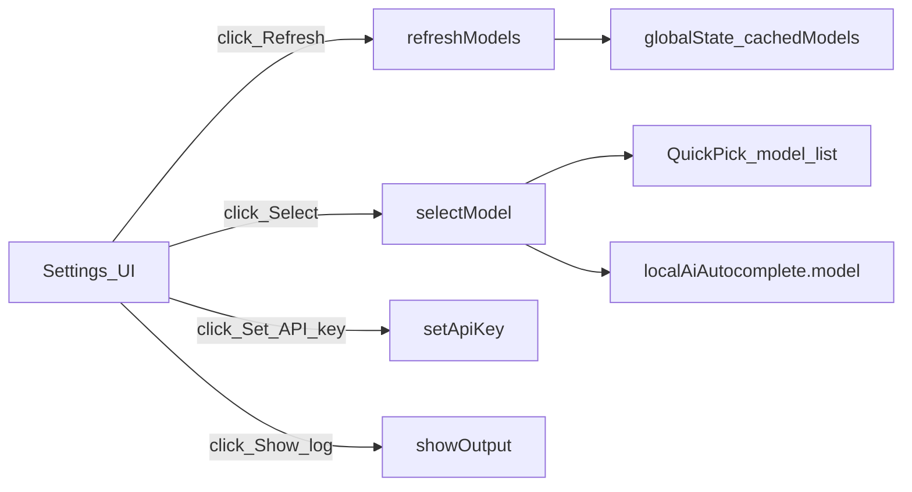

# Settings inline links (connection UX)

## Goal

Users configuring **Local AI Autocomplete** in Settings should see **clickable inline actions** under connection settings—not a dynamic dropdown (not supported by VS Code), but **command links** that run existing handlers and Quick Pick for model selection.

**Scope (per your choice):** `enabled`, `baseUrl`, and `model`, plus a **connection block** at the top of the extension’s settings (reorder properties in [package.json](package.json)).

## How it works (VS Code)

Settings support `markdownDescription` with [command URIs](https://code.visualstudio.com/api/references/contribution-points#contributes.configuration):

```text
[Refresh model list](command:localAiAutocomplete.refreshModels)
```

Requirements already met:

- Commands declared in [package.json](package.json) (`refreshModels`, `selectModel`, `setApiKey`, `showOutput`)
- Handlers in [src/extension.ts](src/extension.ts) (`refreshModelsCommand`, `selectModelCommand`)

No new TypeScript modules required unless we later dedupe copy; **manifest + docs only** for this task.



## Implementation

### 1. Reorder and extend `contributes.configuration` in [package.json](package.json)

Place **connection settings first** (after any future banner-only keys), in this order:

1. `localAiAutocomplete.enabled`
2. `localAiAutocomplete.baseUrl`
3. `localAiAutocomplete.model`

Then existing advanced keys (`maxTokens`, `fimMode`, etc.) unchanged.

For each connection key, add **`markdownDescription`** (keep short plain `description` for search/tooltips):

| Setting | `markdownDescription` content |
|---------|-------------------------------|
| **enabled** | One line: master switch + links — **Set API key**, **Show log**, **Refresh model list**, **Select model** (same four commands). |
| **baseUrl** | Explain URL + **Refresh model list** (primary action after editing URL), **Set API key**, **Show log**. |
| **model** | Explain that value is set by picker or typed + **Select model** (primary), **Refresh model list**, link note that refresh does not auto-fill this field. |

Use exact command IDs (no spaces):

- `command:localAiAutocomplete.refreshModels`
- `command:localAiAutocomplete.selectModel`
- `command:localAiAutocomplete.setApiKey`
- `command:localAiAutocomplete.showOutput`

**JSON escaping:** use `\n\n` between paragraphs in `markdownDescription` strings.

Optional polish (same PR): add `"category": "Local AI Autocomplete"` is not a standard schema field—grouping is achieved by **property order** only.

### 2. Documentation

- [README.md](README.md) — Replace “Command Palette only” setup steps with: open Settings → **Local AI Autocomplete** → use links under **Enabled / Base Url / Model**. Keep palette commands as secondary.
- [docs/SPECIFICATION.md](docs/SPECIFICATION.md) — Add §8.x **Settings inline actions** documenting `markdownDescription` links and that **model** remains `string` + Quick Pick (not a native enum).

### 3. Verification (manual)

In Extension Development Host (F5):

1. Open Settings, filter `localAiAutocomplete`.
2. Confirm **Enabled**, **Base Url**, **Model** appear at the top of the extension’s settings.
3. Click **Refresh model list** under Base Url → toast + log line; `globalState` populated.
4. Click **Select model** under Model → Quick Pick → **Model** field updates.
5. Click **Set API key** from Enabled block → input box; **Show log** opens output channel.

No change to automated tests (manifest-only); run `npm run compile` after edit.

## Out of scope

- Sidebar webview / custom setting renderer
- Dynamic dropdown in Settings bound to `/v1/models`
- Auto-refresh on `baseUrl` change (could be a follow-up; avoids surprise network calls)

## Files touched

| File | Change |
|------|--------|
| [package.json](package.json) | Reorder `properties`; add `markdownDescription` on `enabled`, `baseUrl`, `model` |
| [README.md](README.md) | Setup + troubleshooting reference settings links |
| [docs/SPECIFICATION.md](docs/SPECIFICATION.md) | UX spec for inline settings actions |
| [src/extension.ts](src/extension.ts) | Optional: onboarding message mentions Settings links (see gap review) |

---

## Gap review

Findings cross-checking the plan, [package.json](package.json), and VS Code Settings behavior.

### Not gaps (already OK)

| Item | Notes |
|------|--------|
| Property order | `enabled` → `baseUrl` → `model` already precede advanced keys; work is mainly `markdownDescription`, not reorder. |
| Commands exist | All four command IDs registered with titles; handlers in `extension.ts`. |
| Select without prior refresh | `selectModelCommand` already calls `refreshModelsCommand` when cache is empty. |
| Activation | `onStartupFinished` ensures commands run when Settings links are clicked. |
| Scope | No webview / dynamic enum—aligned with “settings links only.” |

### Gaps to address in implementation

| Gap | Risk | Resolution |
|-----|------|------------|
| **Settings field UI stale after Quick Pick** | User picks model; **Model** text box may not repaint until focus change or re-open Settings. | Document in README; optional follow-up: after `setModel`, run `workbench.action.openSettings` with filter (heavy-handed—defer unless users complain). |
| **First command-link click** | Cursor/VS Code may show a one-time “run command from link?” prompt. | Document in README troubleshooting; not fixable in extension. |
| **`description` + `markdownDescription`** | Duplicate prose if both repeat the same help. | Keep `description` one line for search; put links and workflow only in `markdownDescription`. |
| **Redundant links on three rows** | Same commands repeated under enabled, baseUrl, model (user asked for connection block). | Acceptable; **enabled** = hub for API key + log; **baseUrl** emphasizes refresh; **model** emphasizes select. Avoid duplicating long paragraphs. |
| **Onboarding still palette-centric** | `maybeShowOnboarding` offers “Open Settings” / “Refresh Models” only. | Optional todo: add “use links under Base Url” in message ([src/extension.ts](src/extension.ts)). |
| **Status bar / palette** | Plan silent on secondary entry points. | Keep status bar + Command Palette; README says Settings links are primary. |
| **No automated test for manifest** | Broken command ID in markdown would only fail manually. | Manual verify todo; optional future: JSON lint in CI (out of scope). |
| **markdown escaping** | Unescaped `[`/`]` in model id examples could break links. | Do not use bracketed examples inside link labels; plain text only in `markdownDescription`. |

### Accepted limitations (document, not fix in this PR)

| Item | Why |
|------|-----|
| No dropdown in Settings | VS Code configuration schema has no API-driven enum from HTTP. |
| No refresh button in the `baseUrl` row | Only markdown links, not native buttons. |
| Auto-refresh on `baseUrl` blur | Out of scope; avoids LAN requests on every edit. |
| Workspace vs User settings | Links use same commands; user must configure the window where the extension runs (F5 host vs main)—already in README troubleshooting. |

### Manual verify additions

6. After **Select model**, confirm **Model** value updated (re-open setting or tab away/back if UI lags).  
7. First click on a command link: confirm allow/deny prompt if shown.  
8. Repeat test in **Extension Development Host** (not only main window).

### Spec / README gaps to close

- SPEC §8: distinguish **inline settings actions** (links) vs **Quick Pick** (model selector).  
- README: remove implication that palette is required; add command-link trust note.  
- Clarify that **Refresh** does not populate **Model** until **Select** (or manual paste).
