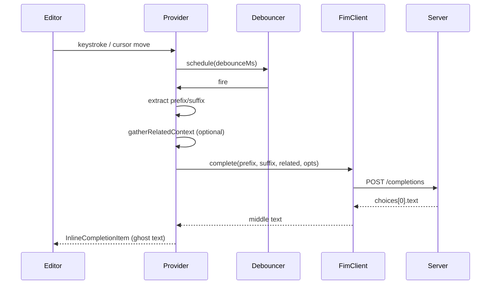

# AI Local Autocomplete — VS Code Extension Specification (MVP)

**Product name (working):** Local AI Autocomplete  
**Workspace:** `vs_autocomplete`  
**Version:** Spec 1.1  
**Date:** 2026-10-19  
**Changelog:** 1.1 — related workspace context for completions (§6.6); align model config and status bar with implementation.

---

## 1. Purpose and goals

### 1.1 Problem

Developers running local LLMs (LM Studio, Ollama, vLLM, llama.cpp server, etc.) want IDE-style ghost-text autocomplete without sending code to a cloud provider. The extension should behave like modern AI completions: suggestions appear inline, respect cursor context before and after the insertion point, and use **Fill-in-the-Middle (FiM)** so the model completes *between* existing code, not only “continue from end of file.”

### 1.2 MVP goals

| Goal | Description |
|------|-------------|
| **G1** | Inline ghost-text completions in the active editor via VS Code’s inline completion API. |
| **G2** | User-configured **OpenAI-compatible HTTP base URL** (and optional API key). |
| **G3** | **Discover models** from the endpoint (`GET /v1/models`) and let the user pick one. |
| **G4** | Completions use **FiM**: send prefix (before cursor) and suffix (after cursor); display only the generated *middle* as ghost text. |
| **G5** | Fail silently in the editor; surface configuration and connectivity issues in a dedicated output channel and status bar. |
| **G6** | Optional **related workspace context**: attach declaration-linked types from other files to the model prompt when enabled (§6.6). |

### 1.3 Non-goals (MVP)

- Cloud vendor-specific SDKs (Anthropic, Gemini, etc.).
- Full-workspace RAG/indexing, embedding search, or automatic inclusion of all open editor tabs.
- Chat panel, refactoring, or command-based “generate code.”
- Streaming ghost text (MVP may use non-streaming responses only).
- Model download or process management (user runs the server).
- Authentication flows beyond optional `Authorization: Bearer <token>`.

---

## 2. User personas and stories

### 2.1 Persona

**Local LLM user** — runs an OpenAI-compatible server on `localhost`, switches models often, cares about latency and not leaking code off-machine.

### 2.2 User stories (MVP)

| ID | Story | Acceptance hint |
|----|--------|-----------------|
| US-1 | As a user, I set base URL and API key in Settings. | Values persist; invalid URL blocked at save with message. |
| US-2 | As a user, I refresh the model list from my endpoint. | Model ids logged to output channel; errors shown there. |
| US-3 | As a user, I set the model id for autocomplete. | Manual `model` string; only that model is used for FiM requests. |
| US-4 | As a user, I get inline suggestions while typing. | Ghost text after debounce; Tab accepts per VS Code defaults. |
| US-5 | As a user, I can disable autocomplete globally. | No network calls when disabled. |
| US-6 | As a user, I see when the extension is loading or misconfigured. | Status bar: idle / loading / error / disabled. |
| US-7 | As a user, I implement a type whose contract is in another file. | With related context enabled, debug log lists related paths; prompt includes those definitions. |

---

## 3. VS Code integration

### 3.1 Extension type

- **Language:** TypeScript  
- **Engine:** `vscode` `^1.86.0` (inline completions + partial accept APIs stable in recent versions)  
- **Activation:** `onStartupFinished` (or lazy init) so completions work without opening a special view.

### 3.2 Core API

Register an `InlineCompletionItemProvider`:

```text
vscode.languages.registerInlineCompletionItemProvider(documentSelector, provider)
```

**Provider contract:**

- `provideInlineCompletionItems(document, position, context, token)` → `InlineCompletionList` or `undefined`.
- Must honor `token` (cancel in-flight HTTP when the user keeps typing).
- Prefer **no thrown errors** from the provider; return `undefined` on failure.

**Document selector (MVP):**

- Default: text documents on `file` scheme.
- Setting: `localAiAutocomplete.languages` — allowlist of language IDs (default: empty = all `file` documents).

### 3.3 Inline completion behavior

| Behavior | Spec |
|----------|------|
| Insert range | Ghost text starts at `position`; range typically zero-width at cursor. |
| Multi-line | Allow `\n` in `insertText`; trim trailing incomplete line if model runs past suffix alignment (see §6.5). |
| Re-trigger | Debounce after document changes; abort previous request. |
| Partial accept | Deferred (not in current implementation). |
| Post-accept guard | Deferred. |

Reference: [VS Code inline completions sample](https://github.com/microsoft/vscode-extension-samples/tree/main/inline-completions).

### 3.4 Commands (MVP)

| Command ID | Title | Behavior |
|------------|--------|----------|
| `localAiAutocomplete.enableToggle` | Toggle Local AI Autocomplete | Flips enabled flag. |
| `localAiAutocomplete.refreshModels` | Refresh Model List | `GET /v1/models`; log ids (user copies into `model` setting). |
| `localAiAutocomplete.openSettings` | Open Settings | Opens `localAiAutocomplete` settings. |
| `localAiAutocomplete.setApiKey` | Set API Key | Store in `SecretStorage`. |
| `localAiAutocomplete.showOutput` | Show Autocomplete Log | Opens output channel. |

---

## 4. Configuration

All settings under namespace `localAiAutocomplete.*` (final ID to match marketplace name).

### 4.1 Settings table

| Key | Type | Default | Description |
|-----|------|---------|-------------|
| `enabled` | boolean | `true` | Master switch. |
| `baseUrl` | string | `http://127.0.0.1:1234/v1` | OpenAI-compatible API root **including** `/v1` if the server uses that layout. |
| `model` | string | `""` | Model id from `/v1/models`; required before completions run. |
| `maxTokens` | number | `128` | Max tokens for completion payload. |
| `temperature` | number | `0.2` | Sampling temperature. |
| `debounceMs` | number | `300` | Delay after last edit before requesting. |
| `requestTimeoutMs` | number | `15000` | HTTP timeout per completion. |
| `prefixMaxChars` | number | `8192` | Max characters before cursor sent to model. |
| `suffixMaxChars` | number | `4096` | Max characters after cursor sent to model. |
| `fimMode` | enum | `completions_suffix` | `completions`, `completions_suffix`, `template`, or `chat_pseudo_fim` (see §5). |
| `fimTemplate` | string | (see §5.3) | Used when `fimMode` is `template`. |
| `stop` | string[] | `["\n\n"]` | Stop sequences passed to API when supported. |
| `languages` | string[] | `[]` | Language IDs to enable; empty = all `file` documents. |
| `debug` | boolean | `false` | Verbose logging to output channel. |
| `includeRelatedContext` | boolean | `true` | Attach related workspace definitions to the model prompt. |
| `relatedContextMaxChars` | number | `8192` | Max total chars from related files per request. |
| `relatedContextMaxFiles` | number | `5` | Max related files per request. |
| `relatedContextStrategy` | enum | `auto` | `auto`, `lsp_only`, or `heuristic_only` (§6.6). |
| `relatedContextIncludeImports` | boolean | `true` | Include file-level imports when gathering related context. |
| `relatedContextAllowVendor` | boolean | `true` | Allow vendor/node_modules paths in related context. |

### 4.2 API key

- Recommended: `SecretStorage` key (e.g. `localAiAutocomplete.apiKey`) set via **Set API Key** command.
- Never log full API key; redact in debug logs.

### 4.3 Base URL normalization

- Trim trailing slashes.
- Document whether users must include `/v1` explicitly (MVP: prefer explicit user value).
- Resolved endpoints:
  - Models: `{baseUrl}/models`
  - Completions: `{baseUrl}/completions` (FiM primary for MVP)

---

## 5. OpenAI-compatible API surface (MVP)

### 5.1 Model discovery

**Request**

```http
GET {baseUrl}/models
Authorization: Bearer {apiKey}   # if configured
```

**Expected response (OpenAI shape)**

```json
{
  "object": "list",
  "data": [
    { "id": "model-name", "object": "model" }
  ]
}
```

**Behavior**

- Parse `data[].id`; sort lexicographically for UI.
- Cache list in extension global state with timestamp.
- On failure: status bar error, log status + body snippet; keep previous list if any.
- Optional: `autoSelectFirstModel` (default `false`).

### 5.2 FiM and “OpenAI compatible”

Standard OpenAI **Chat Completions** do not define FiM. Local code models often implement FiM via:

1. **`/v1/completions` with `prompt` + `suffix`** (extension used by several inference stacks).
2. **Single `prompt` with model-specific tokens** (e.g. CodeLlama-style PRE/SUF/MID markers).
3. **Vendor-specific paths** (out of MVP unless behind `fimMode`).

**MVP requirement:** support at least **(1)** and **(2)** via `fimMode`.

### 5.3 FIM modes

| `fimMode` | HTTP | Body shape |
|-----------|------|------------|
| `completions` | `POST {baseUrl}/completions` | `{ model, prompt, max_tokens, temperature, stop, stream: false }` (prefix only; no `suffix`) |
| `completions_suffix` | `POST {baseUrl}/completions` | `{ model, prompt, suffix, max_tokens, temperature, stop, stream: false }` |
| `template` | `POST {baseUrl}/completions` | `{ model, prompt: render(template, prefix, suffix), max_tokens, ... }` |
| `chat_pseudo_fim` (optional, off by default) | `POST {baseUrl}/chat/completions` | User message with fenced prefix/suffix; **not true FiM** — escape hatch only |

**Default `fimTemplate`** (example for CodeLlama-style; user-editable):

```text
<PRE>{prefix}<SUF>{suffix}<MID>
```

Placeholders: `{prefix}`, `{suffix}`.

**Related context and FiM:** When `includeRelatedContext` is on, a related block is prepended to the API `prompt` (or chat user message). Editor `{prefix}` / `{suffix}` in `fimTemplate` stay unwrapped; post-processing uses unwrapped editor prefix/suffix. See §6.6 and [RELATED_CONTEXT.md](RELATED_CONTEXT.md).

### 5.4 Completion response parsing

Support OpenAI completions response:

```json
{
  "choices": [
    { "text": "generated middle...", "finish_reason": "stop" }
  ]
}
```

- Use `choices[0].text`.
- MVP: `stream: false` only; streaming deferred to post-MVP.

### 5.5 Server capability probe (post-MVP)

Optional lightweight probe; MVP relies on user-selected `fimMode` and README compatibility matrix.

---

## 6. FiM pipeline (logical design)

### 6.1 Data flow



### 6.2 Prefix/suffix extraction

| Rule | Detail |
|------|--------|
| Prefix | Text ending at `position`, bounded by `prefixMaxChars` (keep nearest to cursor). |
| Suffix | Text starting at `position`, bounded by `suffixMaxChars`. |
| Line integrity | Prefer not to cut mid-UTF-16 surrogate; use document offset APIs. |
| Empty suffix | Allowed; FiM degrades to “continue at cursor.” |
| Suffix extraction | Always performed for post-process; `fimMode: completions` omits API `suffix` only. |

### 6.3 When **not** to request

- Extension disabled or no `model` configured.
- Empty `baseUrl`.
- Selection is non-empty (optional: skip).
- Language not in allowlist (when configured).
- Document `uri.scheme` not `file` (MVP).
- Duplicate in-flight or short-TTL cache hit for same context hash (optional).

### 6.4 Post-processing of model output

1. Strip leading whitespace if it duplicates prefix ending (heuristic).
2. If model echoes suffix prefix, truncate at overlap with actual suffix.
3. Apply `stop` sequences client-side if server ignored them.
4. Cap display length to avoid UI freeze.

### 6.5 Caching (optional MVP)

- Key: document URI, version, model, fimMode, hash(prefix), hash(suffix), hash(relatedContext).
- TTL: ~5 s; `clearCache` when related-context settings change.

### 6.6 Related context

When `includeRelatedContext` is true, before cache lookup the provider gathers snippets from other workspace files linked by **type declarations** and optional **file-level imports** (`relatedContextIncludeImports`). Resolution is **LSP-first** (`Definition` / `TypeDefinition`), then generic declaration heuristics and `workspace.findFiles` (vendor/`node_modules` governed by `relatedContextAllowVendor`). Payload is prepended to the model prompt only; ghost-text insertion still uses the active document prefix/suffix. Fail-open on errors. Disable `includeRelatedContext` to restrict HTTP payload to the active file only.

Technical detail: [RELATED_CONTEXT.md](RELATED_CONTEXT.md).

---

## 7. Software architecture (implementation reference)

This section guides a future implementation; it is not part of the MVP deliverable unless explicitly scoped.

### 7.1 Suggested module layout

```text
src/
  extension.ts              # activate/deactivate, register provider & commands
  config.ts                 # read/sync settings + secrets
  completion/
    provider.ts             # InlineCompletionItemProvider
    relatedContext.ts       # gather related workspace snippets
    related/                # discover, lsp, fallback, budget, prompt
    context.ts              # prefix/suffix extraction
    postprocess.ts          # trim, overlap, stop
  api/
    client.ts               # fetch wrapper, timeout, auth headers
    models.ts               # listModels()
    fim.ts                  # build request body by fimMode, parse response
  ui/
    statusBar.ts
    output.ts
```

### 7.2 Dependencies

- Prefer `fetch` (Node 18+ / VS Code runtime); optional schema validation (e.g. `zod`).

### 7.3 Concurrency

- Replace in-flight request with `AbortController` on each new trigger after debounce.

---

## 8. UX specification

### 8.1 Status bar

| State | Text | Tooltip |
|-------|------|---------|
| Disabled | `AI: off` | Click to enable |
| Ready | `AI: {modelShort}` | Base URL; click to open settings |
| Loading | `AI: …` | Fetching completion |
| Error | `AI: !` | Last error summary |
| No model | `AI: no model` | Set `localAiAutocomplete.model` in Settings |

### 8.2 Onboarding

First activation with empty `model` (and extension enabled): information message with **Open Settings**; user types model id manually.

### 8.3 Model configuration

`localAiAutocomplete.model` is a **string** set by the user (exact id from `GET /v1/models`). Optional **Refresh Model List** command logs ids to the output channel; no model picker.

### 8.4 Editor experience

- Completions use VS Code inline suggest keybindings.
- No modal dialogs during typing.
- Errors only in output channel + status bar (except manual refresh failure may toast).

---

## 9. Security and privacy

See **[SECURITY.md](SECURITY.md)** for workspace trust, per-host approval, payload files, and API key handling.

| Topic | Requirement |
|-------|-------------|
| Data residency | Code in prefix/suffix and (when enabled) related workspace files sent only to user-configured URL after user approves that host. |
| Workspace trust | Extension inactive in Restricted Mode (`untrustedWorkspaces.supported: false`). |
| `baseUrl` | `http`/`https` only; validated at use time and on settings change (VS Code cannot block invalid settings on save). |
| TLS | Support `https://`; no certificate pinning in MVP. |
| Logging | Debug mode may log code fragments; default logs lengths/hashes where applicable. |
| SSRF | Per-host approval dialog (not loopback-only blocklist in MVP). |

---

## 10. Error handling

| Layer | Policy |
|-------|--------|
| Inline provider | Return `undefined`; no error toast on each keystroke. |
| Model refresh | Toast on manual refresh failure only. |
| HTTP 401/403 | Status bar “auth failed”; log once per session. |
| Timeout | Abort; treat as no suggestion. |
| Malformed JSON | Log parse error; no suggestion. |

---

## 11. Performance targets (MVP)

| Metric | Target |
|--------|--------|
| Debounce | Configurable; default 300 ms |
| p95 time-to-ghost (local 7B, warm server) | &lt; 2 s (environment-dependent) |
| Extension activate | &lt; 500 ms excluding network |
| Memory | Bounded cache (e.g. 50 entries max) |
| Related gather | Once per debounced completion; parallel URI resolution |

---

## 12. Testing strategy

### 12.1 Unit tests

- Prefix/suffix truncation.
- Post-process: suffix overlap removal, stop sequences.
- FIM body builder per `fimMode` (including `relatedContext`).
- Related discover, prompt wrap, budget assembly.
- Response parser fixtures.

### 12.2 Integration tests

- Mock HTTP server for `/models` and `/completions`.
- Provider returns item on success; `undefined` on 500/timeout.

### 12.3 Manual test plan

1. Point at LM Studio / Ollama OpenAI bridge; refresh models; select model.  
2. Type mid-function; verify ghost completes between braces (FiM).  
3. Fast typing — only latest request wins.  
4. Wrong API key — no ghost text; status shows auth issue.  
5. Disabled — no server traffic.

---

## 13. Compatibility notes (user documentation)

| Server | Typical base URL | Suggested `fimMode` |
|--------|------------------|---------------------|
| LM Studio | `http://localhost:1234/v1` | `completions_suffix` if supported; else `template` |
| llama.cpp server | varies | often `template` |
| vLLM | `/v1` | `completions` (OpenAI server rejects `suffix` on `/completions`) |
| Ollama OpenAI compat | `/v1` | per model; may need `template` |

Users must match **model card** FIM token format when using `template`.

---

## 14. MVP acceptance criteria

- [ ] User can configure `baseUrl` and API key.  
- [ ] “Refresh Model List” logs model ids from `GET /v1/models`.  
- [ ] Configured `model` string is persisted and shown in status bar.  
- [ ] Inline ghost completions with cursor **between** existing code (FiM).  
- [ ] Requests use prefix + suffix per `fimMode`.  
- [ ] In-flight request cancelled on subsequent edits within debounce window.  
- [ ] Extension fails silently in editor on server errors.  
- [ ] User-facing README documents setup, `fimMode`, related context, and server limitations.  
- [ ] Related context on/off; debug shows related paths when enabled.

---

## 15. Future roadmap (post-MVP)

- Streaming inline updates.  
- RAG / embeddings; all open tabs; symbol-at-cursor for related types.  
- Per-language `temperature` / `maxTokens`.  
- Automatic `fimMode` detection via server metadata.  
- Additional enterprise policy hooks beyond host approval.  
- Opt-in telemetry (latency only, no code).

---

## 16. Deliverables

| Artifact | Description |
|----------|-------------|
| `docs/SPECIFICATION.md` | Canonical product spec |
| `docs/RELATED_CONTEXT.md` | Related context technical supplement |
| `README.md` | User setup, FiM modes, compatibility |
| `package.json` / `src/` | VS Code extension implementation |
| `test/` | Unit tests + mock HTTP integration tests |

---

## 17. Resolved decisions (implementation)

| Topic | Decision |
|-------|----------|
| Extension ID / settings | `local-ai-autocomplete`, namespace `localAiAutocomplete.*` |
| API key | `SecretStorage` only (`Set API Key` command) |
| Default `fimMode` | `completions_suffix` |
| `languages` default | Empty = all `file` documents |
| `chat_pseudo_fim` | Included in MVP; off unless user selects it |
| `autoSelectFirstModel` | Deferred |
| SSRF / remote URL warnings | Deferred (v1.1) |
| Invalid `baseUrl` on save | Not blockable in VS Code UI; validate on change + log |
| Related context | Default on; strategy `auto`; LSP-first, no per-language parsers in extension |
